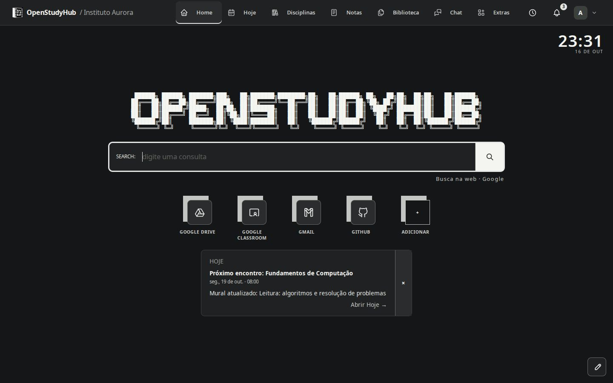
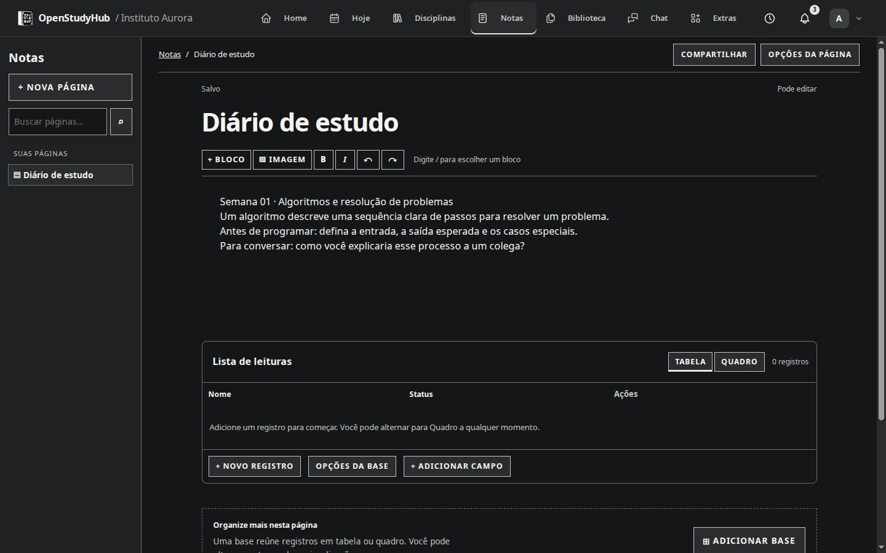

<p align="center"></p>

# OpenStudyHub

[English](README.md) · [Português (Brasil)](README.pt-BR.md) · [Documentação](https://richardspinola.github.io/OpenStudyHub/pt-BR/)

**Seu dia de estudo em um espaço que você pode hospedar.**

O OpenStudyHub reúne aulas, materiais, notas, arquivos e conversas. Estudantes usam o App; os responsáveis pela instância usam um Admin privado separado. Comece com contas e armazenamento locais e conecte Google Classroom ou Drive quando precisar.



<a id="o-que-a-v2-oferece"></a>

## O que você pode fazer

| Área          | Recursos                                                                                                                              |
| ------------- | ------------------------------------------------------------------------------------------------------------------------------------- |
| Seu dia       | Home, pesquisa e atalhos personalizáveis; grade semanal, próximas aulas, eventos, prazos, tarefas pessoais e exportação de calendário |
| Disciplinas   | Espaços das disciplinas com avisos, atividades, materiais e notas/documentos/projetos associados                                      |
| Notas         | Páginas e subpáginas privadas, blocos ricos, bases em tabela/quadro, imagens, compartilhamento, rascunhos de recuperação e exportação |
| Biblioteca    | Arquivos locais, documentos com modelos, projetos pessoais ou associados, versões, compartilhamento, arquivamento e exclusão          |
| Comunidade    | Chat global, grupos e conversas diretas; edição na conversa, anexos e envio por arrastar e soltar                                     |
| Ferramentas   | Quadro colaborativo, nove jogos, Pomodoro, flashcards e assistente de IA local opcional, habilitados pela administração               |
| Seu espaço    | Perfil, temas, enquadramento/desfoque do wallpaper, movimento/contraste, notificações e tour que pode ser repetido                    |
| Administração | Setup, instituições, cursos, turmas/períodos, disciplinas/capas, matrículas, contas, papéis com escopo e duas etapas opcionais        |
| Operação      | Google opcional, controles do Drive central, backup/recuperação, diagnóstico e rodapé configurável do login                           |

### Google é opcional

Notas, arquivos e projetos locais funcionam sem Google. Cada pessoa conecta seu **Classroom somente de leitura** e confirma as associações. O Admin escolhe separadamente uma conta autorizada para o **Drive central**. A geração de documentos Google exige esse armazenamento; um projeto local não é espelhado automaticamente no Drive. Veja [integrações](docs/pt-BR/google.md).

### IA local é opcional

O assistente fica desativado até que um administrador conecte um servidor Ollama ou compatível com OpenAI ao qual a instância já tenha acesso. O OpenStudyHub não instala modelos nem envia dados por conta própria a serviços de IA na nuvem. As conversas são privadas, as fontes são escolhidas explicitamente e o acesso é conferido em cada pedido. [Guia da IA local](docs/pt-BR/local-ai.md).

### Sua instância, seus dados

App, Admin privado, realtime, migrations e proxy local usam dados persistentes: dois bancos SQLite e assets privados. O App pode ficar público com HTTPS e o Admin em localhost ou rede privada protegida. Backups cobrem dados locais geridos; arquivos somente no Drive precisam de proteção própria.

## Comece

- **Vai usar uma instância existente?** Peça endereço e conta local à administração. Veja [primeiro acesso](docs/pt-BR/getting-started.md).
- **Vai hospedar uma nova?** Siga [instalação](docs/pt-BR/instalacao-do-zero.md). O assistente Bash usa Docker/Compose existente e recusa sobrescrever outra instalação.
- **Vai atualizar?** Leia [backup e atualização](docs/pt-BR/backup-update.md). Não refaça a primeira instalação nem remova volumes.

> **Versão 3.1.0:** use a imagem fixa `ghcr.io/richardspinola/openstudyhub:3.1.0`. Veja a [release](https://github.com/RichardSpinola/OpenStudyHub/releases/tag/v3.1.0) e siga o [guia de atualização](docs/pt-BR/backup-update.md) para uma instância existente. O instalador guiado é apenas para instâncias novas.

```sh
# Na cópia completa e confiável, depois de a imagem pública estar disponível:
bash scripts/install-server.sh --language pt-BR
# Diagnóstico de instância criada pelo assistente, sem alterar dados:
bash scripts/install-server.sh --language pt-BR --diagnose --directory ./openstudyhub
```

Os padrões são App `127.0.0.1:3000` e Admin `127.0.0.1:3001`. O assistente não instala Docker, configura domínio/TLS, abre firewall nem atualiza instâncias. Veja [instruções completas e SSH](docs/pt-BR/instalacao-do-zero.md).

## Conheça o espaço

[](docs/pt-BR/notas.md)

- [Home, Hoje e disciplinas](docs/pt-BR/workspace.md)
- [Notas, bases e imagens](docs/pt-BR/notas.md)
- [Biblioteca, documentos e projetos](docs/pt-BR/library.md) · [Modelos personalizados](docs/pt-BR/modelos-personalizados.md)
- [Chat, quadro, jogos, foco e flashcards](docs/pt-BR/chat-e-extras.md)
- [Planejamento e tour](docs/pt-BR/agenda-e-tour.md) · [Configurações](docs/pt-BR/configuracoes.md)
- [Assistente de IA local](docs/pt-BR/local-ai.md) · [Duas etapas do administrador](docs/pt-BR/admin-mfa.md)
- [Guia do Admin](docs/pt-BR/deployment/ADMIN_GUIDE.md) · [Implantação](docs/pt-BR/deployment.md)
- [ZimaOS](docs/pt-BR/zimaos.md), [CasaOS](docs/pt-BR/casaos.md), [UmbrelOS](docs/pt-BR/umbrelos.md)
- [Recuperação](docs/pt-BR/operations/manual-backup-restore.md) · [Solução de problemas](docs/pt-BR/troubleshooting.md)
- [Extensão Nova Aba](docs/pt-BR/extension.md)

Os guias têm versões completas em inglês e **Português (Brasil)**. As capturas usam dados fictícios locais. O setup atual ainda tem rótulos em português; o guia em inglês registra essa limitação real.

## Desenvolva e contribua

Use Node.js 24 e pnpm 10. Não versione `.env`, bancos, uploads ou backups. Desenvolva em ambiente descartável, nunca com dados do servidor real. Veja [contribuição](docs/pt-BR/contributing.md), [arquitetura](docs/pt-BR/architecture.md) e [segurança](docs/pt-BR/security.md).

Para visualizar a documentação bilíngue:

```sh
bash scripts/preview-docs.sh
# Compilar/conferir sem iniciar a prévia:
bash scripts/preview-docs.sh --build-only
```

## Licença, créditos e versões

OpenStudyHub usa **AGPL-3.0-only**. Os componentes preservam seus avisos e licenças originais, incluindo Excalidraw, BlockNote e Yjs. Leia [LICENSE](LICENSE), [avisos de terceiros](THIRD_PARTY_NOTICES.md) e [licenças](docs/pt-BR/LICENSING.md). O desenvolvimento usa assistência de IA sob direção do mantenedor; veja [uso de IA](docs/pt-BR/ai-usage.md).

A apresentação descreve o espaço atual. Mudanças de cada versão ficam no [CHANGELOG](CHANGELOG.md) e nas [notas de versão](RELEASE_NOTES.md). As instâncias são operadas independentemente; informe corretamente o vínculo com a instituição.
