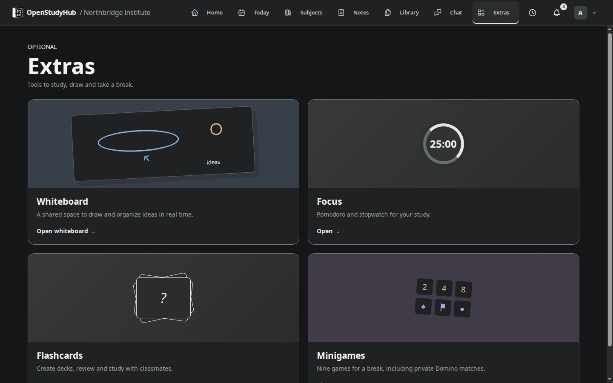

# Chat and study tools

## Conversations

Choose the global chat, a group or a direct conversation. Write in the composer and send. Your own messages can be edited inline; edited messages are identified. Menus close when you click outside. When reading older messages, use the down arrow to return to the latest messages without losing your draft.

Use the attachment control or drag images/files into the composer. Review the attachment before sending; the type and size limits displayed by the interface apply. Uploading a file does not make it public outside the conversation. The application's normal permissions still govern downloads.

An instance-wide chat image is an administrative/moderation responsibility, distinct from personal conversation appearance. Notifications and browser permission are configured separately; the operating system may still silence notifications.

## Extras

The administrator chooses which Extras are available. If an entry is missing, ask whether it is enabled or whether an exam restriction is active.

- **Whiteboard:** collaborative Excalidraw-based canvas for drawing and diagrams.
- **Games:** the catalog includes Snake, 2048, Minesweeper, Solitaire, Dominoes and additional enabled games. The interface adapts to the available area.
- **Focus:** a Pomodoro timer for focus/break cycles; its navigation control uses the shared application style.
- **Flashcards:** create and review study cards in your own space.
- **AI assistant:** appears only when the administrator has connected and enabled a local model. Ask study questions, attach files or pick notes and documents as sources, and share a copy with a study group. In group chats whose owner allows it, write `@IA` to get a reply in the room. See the [local AI guide](local-ai.md).

Game victory sound is controlled in appearance settings. Browser autoplay policies may require interaction before audio. Decorative confetti and transitions respect reduced motion. These tools do not replace your saved academic timetable or grading system.

<!-- Compatibility anchors for previously published guide links. -->

