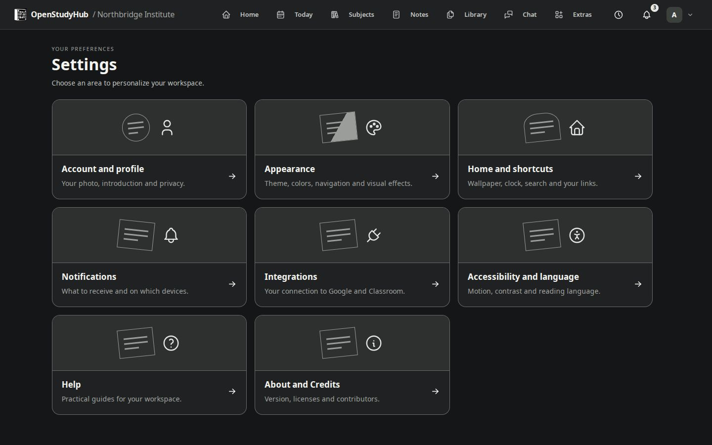

# Settings and accessibility

Open your account menu → **Settings**. Cards lead to Profile, Appearance, Home and shortcuts, Notifications, Integrations, Accessibility and language, Help, and About/Credits.

- **Profile:** photo, presentation and privacy. Review the form and explicitly save where requested.
- **Appearance:** Material/Legacy style, light/dark/system mode, density, color, navigation, wallpaper blur and optional game sound.
- **Home:** wallpaper framing, clock, Today summary, movable customization control, shortcuts, search engine and whether search uses the same tab.
- **Notifications:** categories and device/browser permission. Permission on one device does not configure every device.
- **Integrations:** your Google connection and classroom associations.
- **Accessibility and language:** reduced motion, contrast and interface language. Languages are **English** and **Português (Brasil)**.
- **Help:** task-oriented guides and the guided tour.
- **About and Credits:** running package version, project license and third-party software.

Simple preferences show autosave status. If saving fails, retry before leaving. Wallpaper blur is decorative and optional; high contrast or reduced transparency can suppress it. Notes, games, the whiteboard and chat retain their own workspace behavior. Reduced motion applies across user pages without animating every message or timer update.

The public documentation's default language does not change the instance's interface language. A login footer is edited only by Admin under System → Appearance and identity; it can contain a plain-text independence notice and project/contact links.

<!-- Compatibility anchors for previously published guide links. -->

