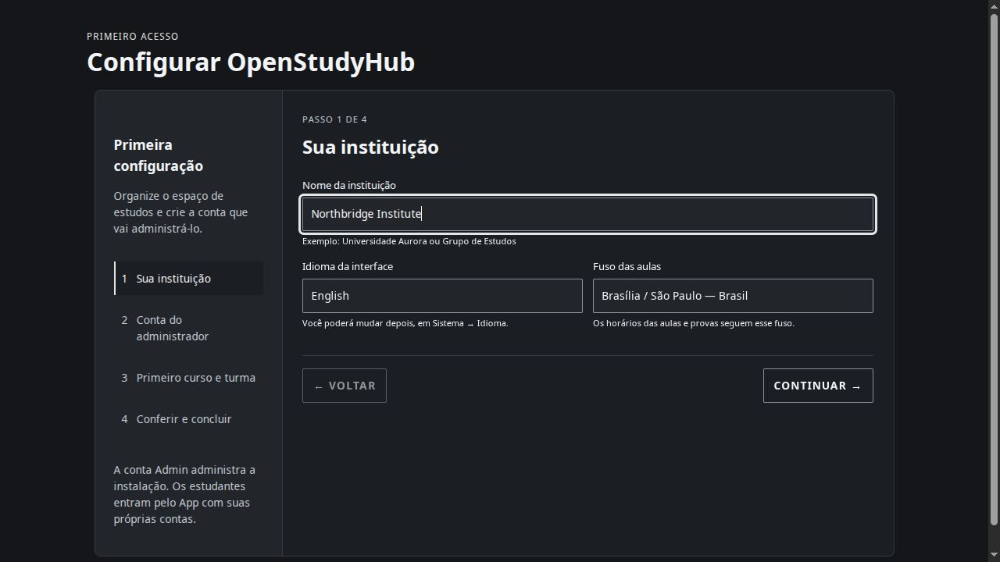

# Admin guide

The Admin is a separate, private surface of the same instance. A normal user account is not an Admin account. Open the private Admin address and sign in; complete a required password change before using administrative actions.

## First configuration

On an empty canonical database, `/control/setup` asks for language, the first administrator, institution, course and initial academic structure. Review the summary before finishing. Keep the institution timezone and academic period dates correct: Today and deadlines depend on them.

## Organize the instance

- **Institutions:** manage identity, courses, cohorts/terms, subjects and offerings. Choose the intended institution before changing its data.
- **Subjects and covers:** edit subject details, class times, teachers and cover images in their dedicated area. Restore a default cover when needed.
- **Users:** accounts, enrollment and lifecycle. An inactive account should not be granted new access.
- **Managers and permissions:** grant only the responsibility and academic scope needed. Management access is not unrestricted instance administration.
- **Integrations:** inspect personal connections separately from central Drive storage and synchronization automation.
- **Extras:** enable the tools available to users.
- **System:** branding, default links/icons, languages, tour invitation, login footer, autocomplete, backups and diagnostics.

## Appearance and public login

Keep the application brand separate from the institution name. Configure default shortcut icons without overwriting personal choices. Under **System → Appearance and identity**, the login footer can be enabled/disabled and contain optional text and up to four HTTPS/contact links. Use an accurate affiliation statement; the software does not verify institutional endorsement.

## Operations

Check storage state before generating documents. Use explicit root creation/recovery controls when a Drive folder is missing; read the warning before replacing a reference. Do not reset the library as part of an ordinary update. Read [Google](../google.md) and [backup/recovery](../operations/manual-backup-restore.md).

Keep Admin on localhost or a protected private network. Publishing the student App does not require publishing Admin.

> The current first-run wizard has Portuguese labels, including when English is selected. The choice sets the instance language after setup; the screenshot shows the real interface. This documentation change does not translate application code.

<!-- Compatibility anchors for previously published guide links. -->

