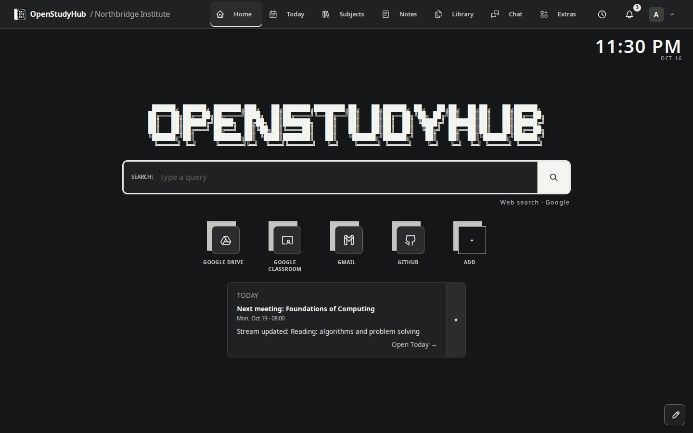
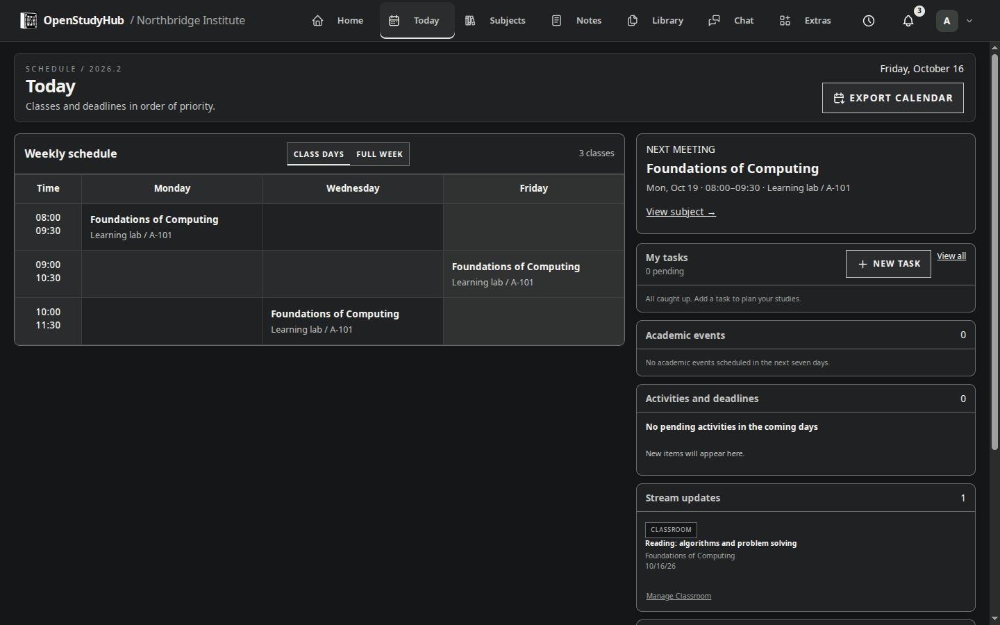
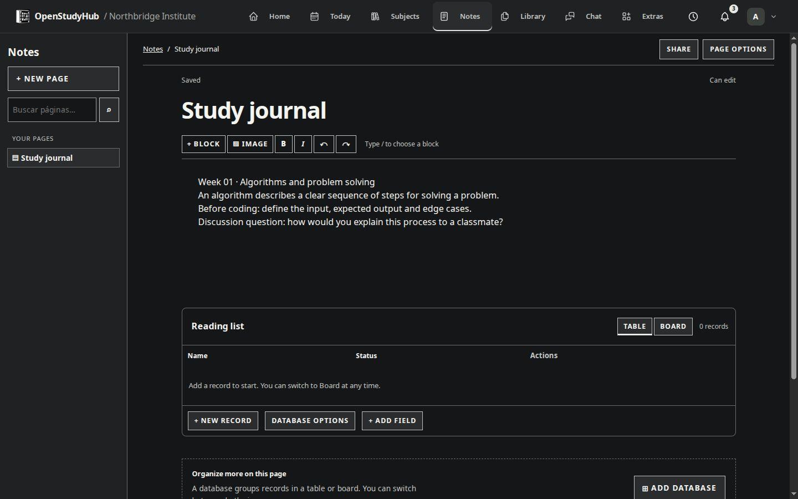
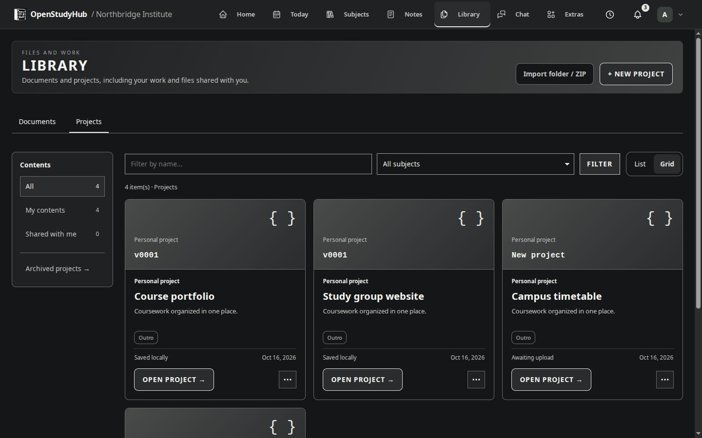
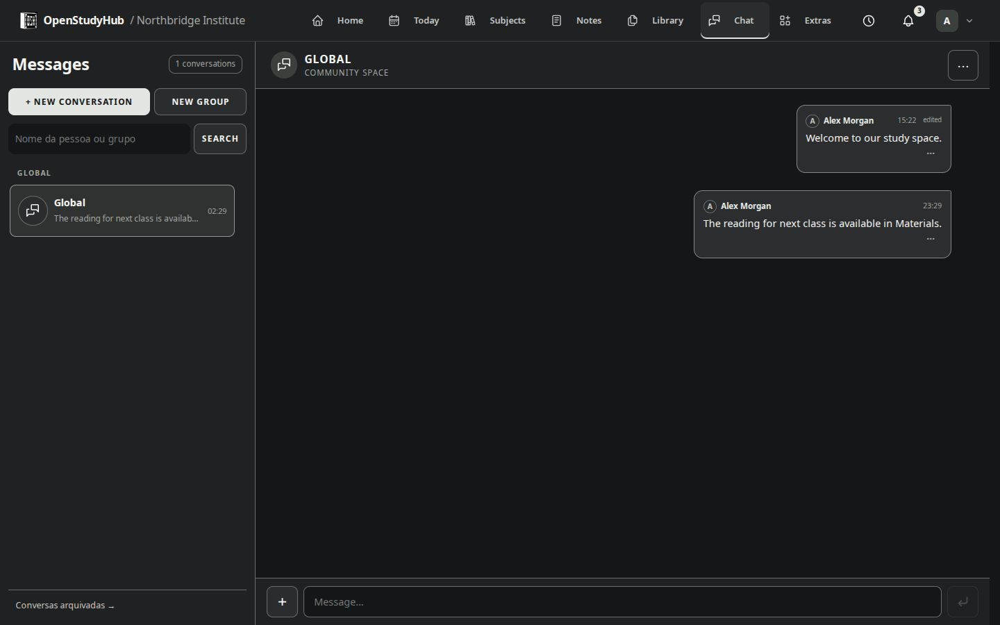
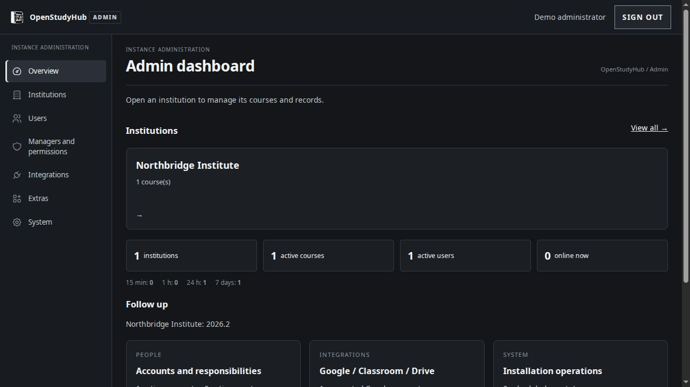

---
hide:
  - navigation
  - toc
---

  <header class="tui-titlebar">OpenStudyHub / docs<nav aria-label="Documentation"><a href="getting-started/">Documentation</a><a href="https://github.com/RichardSpinola/OpenStudyHub">GitHub ↗</a></nav></header>
  

    <aside class="tui-sidebar"><nav aria-label="Sections"><a href="#overview" data-tui-link="overview" aria-current="page">01 Overview</a><a href="#workspace" data-tui-link="workspace">02 Workspace</a><a href="#administration" data-tui-link="administration">03 Administration</a><a href="#hosting" data-tui-link="hosting">04 Installation</a><a href="#faq" data-tui-link="faq">05 Questions</a></nav></aside>
    

      <section class="tui-panel" id="overview" data-tui-panel aria-labelledby="osh-title">

<h1 id="osh-title">OpenStudyHub</h1>

Subjects, notes, files and conversations in your own study workspace. Connect Google when you need it.

<a href="#workspace" data-tui-link="workspace">Explore workspace</a><a href="instalacao-do-zero/">Installation guide</a>
<dl class="tui-system">
<dt>Storage</dt><dd>Local / optional Drive</dd>

<dt>AI</dt><dd>Optional / your local server</dd>

<dt>License</dt><dd>AGPL-3.0-only</dd>
</dl>
<figure class="tui-capture"></figure>
</section>
      <section class="tui-panel" id="workspace" data-tui-panel aria-labelledby="tui-workspace-title"><h2 id="tui-workspace-title">Workspace</h2>
<button type="button" data-tui-preview="0" aria-pressed="true">01 Schedule</button><button type="button" data-tui-preview="1" aria-pressed="false">02 Notes</button><button type="button" data-tui-preview="2" aria-pressed="false">03 Library</button><button type="button" data-tui-preview="3" aria-pressed="false">04 Chat</button>

[01] Today & subjects

Timetable, deadlines, materials and your subject workspaces. <a href="workspace/">Open guide →</a>

[02] Notes

Pages, subpages, images and simple databases. <a href="notas/">Open guide →</a>

[03] Library & projects

Documents, templates, files, versions and sharing. <a href="library/">Open guide →</a>

[04] Chat & study tools

Conversations, attachments, whiteboard, games, focus, flashcards and an optional local AI assistant. <a href="chat-e-extras/">Open guide →</a>

</section>
      <section class="tui-panel" id="administration" data-tui-panel aria-labelledby="tui-admin-title"><h2 id="tui-admin-title">Administration</h2>
Institutions, courses, classes, accounts and permissions. Manage integrations and maintenance from a separate private Admin, with optional two-step sign-in.

<a href="deployment/ADMIN_GUIDE/">Admin guide</a>
<figure class="tui-capture"></figure></section>
      <section class="tui-panel" id="hosting" data-tui-panel aria-labelledby="tui-hosting-title"><h2 id="tui-hosting-title">Installation</h2>
Linux + Docker Engine + Compose v2. Five services and persistent data. The new-install wizard checks your choices before creating an instance.
<ul class="tui-options"><li>
<h3>New instance</h3>
Guided installation with Docker already installed.

<a href="instalacao-do-zero/">Install →</a></li><li>
<h3>Existing instance</h3>
Preserve data and keys. Follow the update guide.

<a href="backup-update/">Update →</a></li><li>
<h3>Google integration</h3>
Personal Classroom and administered Drive are separate.

<a href="google/">Configure →</a></li></ul>
Pinned image: ghcr.io/richardspinola/openstudyhub:3.1.0. Back up existing instances before updating.

Other hosts: <a href="zimaos/">ZimaOS</a> / <a href="casaos/">CasaOS</a> / <a href="umbrelos/">UmbrelOS</a>
</section>
      <section class="tui-panel tui-faq" id="faq" data-tui-panel aria-labelledby="tui-faq-title"><h2 id="tui-faq-title">Questions</h2>

Do I need Google?

No. Local accounts, notes, local files and projects work without Google. Classroom import and Google-backed document workflows need their respective integration.

Where are my files stored?

In the instance’s local storage or the administered Drive, depending on the workflow. A local backup does not download files that exist only on Drive.

Does it send my work to an AI service?

No, not by itself. The AI assistant is off until an administrator connects a model server the instance already uses, such as Ollama on the local network. People then choose which notes or files to include.

Is hosting free?

The source is open under AGPL-3.0-only. You provide the server, domain and any external services; those can have their own costs.

Can I use ZimaOS, CasaOS or UmbrelOS?

Compose instructions are provided for compatible hosts. These are manual deployments, not official one-click app-store packages.

Can I use a phone?

The workspace and documentation adapt to smaller screens. Some tasks, such as editing a large board or administering a server, are easier with more space.

<footer class="tui-about">
Independent, open-source study software.
<a href="LICENSING/">License & credits</a></footer></section>
    

  

