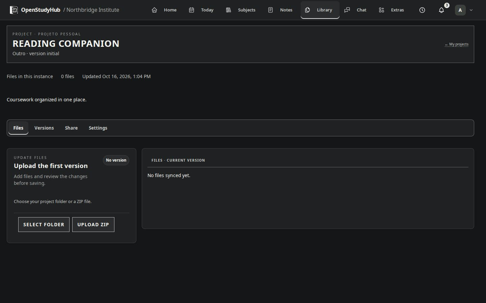

# Library, documents and projects

Library separates **Documents** and **Projects**. Use All, My content and Shared with me to locate items. Filter by name or subject and choose list or grid view. Archived projects have their own entry in the content navigation.

## Files and documents

Import a local file, or create a document from an available template. Local uploads do not require Google. Template-based Google document generation requires the instance's central Drive to be ready; connecting your personal Classroom alone is not enough.

Choose a template, fill the requested fields, review and create. In **App access** mode, the central Drive retains the copy and Hub offers viewing/downloading a PDF without granting new Google access. **Google Docs access** authorizes the owner to edit the new document. Existing Google permissions are not revoked when the administrator changes this setting for future documents.

Share eligible items with a person or group using the item's menu. Internal Hub sharing and Google permissions are separate layers. A shared Hub item does not automatically grant arbitrary access in Google Drive.

## Projects

Create a personal project or associate it with a subject. Open the project, select a folder or ZIP, inspect the proposed changes and submit the version. The Hub stores project files; it does not execute uploaded code. Exclusions and upload limits shown in the interface apply.

Projects can use local instance storage or the administered Drive, depending on configuration and the project. Check its displayed storage destination. A local project is not automatically mirrored into Google Drive.

The project menu exposes available actions, including sharing, archiving and permanent deletion for the owner. Archiving and deleting are different: archiving keeps the project; deletion removes its records/files and requires confirmation. A refused Drive deletion preserves the local records so you can resolve the remote problem.

For remote files that were deleted or are not authorized to this OAuth client, ask the administrator to inspect [Drive storage](google.md). Do not repeatedly create duplicate folders to work around a permission error.
