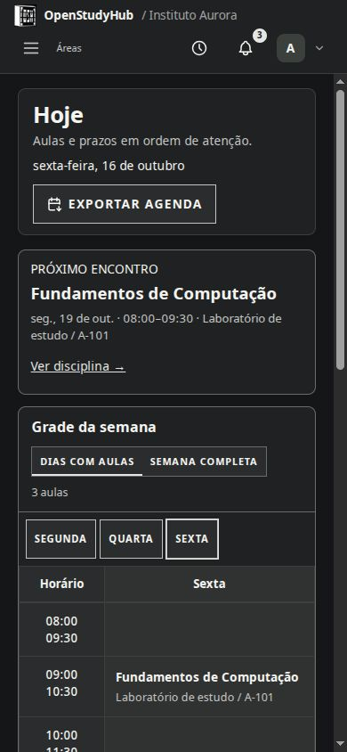

# Home, Hoje e disciplinas

## Home

Pesquise com o provedor escolhido nas configurações. As sugestões são opcionais: a administração precisa configurar o autocomplete Brave, e o texto digitado é enviado ao provedor quando o recurso está ativo. Uma falha nas sugestões não impede a pesquisa normal.

Atalhos aceitam iniciais, ícone do site, ícone do catálogo ou imagem enviada. O ícone do site depende do que ele disponibiliza; confira a prévia e escolha outra opção se não for encontrado. A administração define padrões da instância; cada pessoa personaliza seus atalhos.

Escolha um wallpaper e ajuste o enquadramento visualmente. A Home também tem relógio opcional, lápis de personalização movível e resumo de Hoje. O rodapé do login é definido pelo Admin e aparece apenas antes de entrar na conta.

## Hoje e grade semanal

Hoje reúne horários acadêmicos, próximos encontros, eventos, prazos e atualizações do Classroom em cache. Alterne entre dias com aula e semana completa. A grade segue os horários inicial e final cadastrados; ela não edita matrículas. Use o seletor de período para consultar outros semestres.

## Disciplinas

Cada disciplina reúne visão geral, horários, avisos, atividades, materiais e notas/documentos/projetos associados. O item precisa estar associado à disciplina para aparecer ali; um projeto pessoal sem associação continua na Biblioteca.

O Classroom aparece depois de associar e sincronizar sua própria conexão Google. Uma lista vazia em cache não prova que o professor não publicou nada. Confira a conexão e a última sincronização em [Google](google.md). Materiais são separados de atividades e avisos.

## No celular

A navegação e as disciplinas se adaptam à largura disponível. Tarefas com muitos arquivos podem ser mais confortáveis em uma tela maior.

