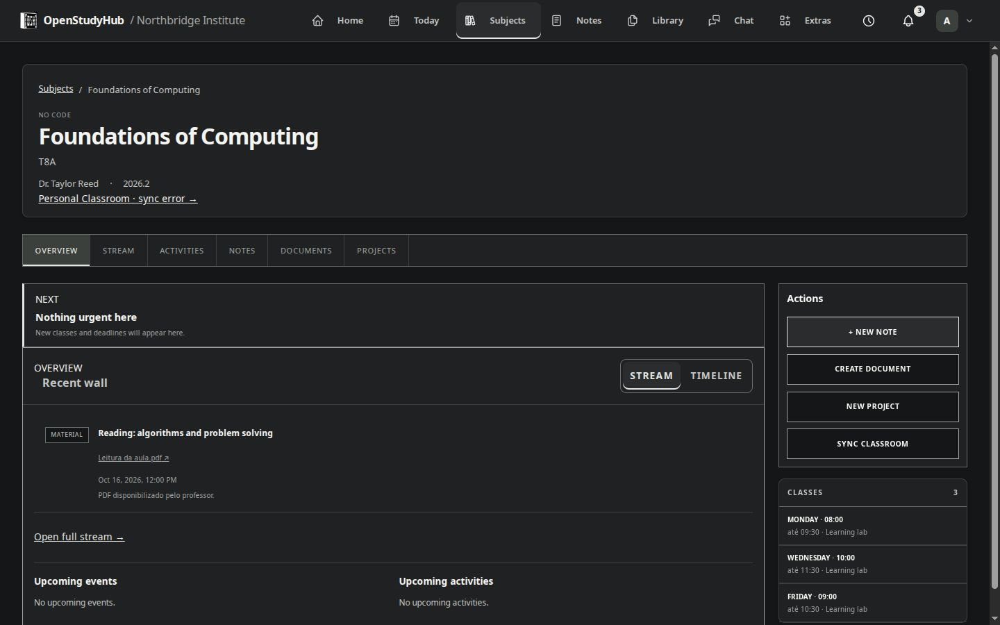

# Home, Today and subjects

## Home

Search with the provider selected in Settings. Suggestions are optional: the administrator must configure Brave autocomplete, and typed text is sent to that provider when enabled. A failed suggestion request does not prevent a normal search.

Shortcuts support initials, a website icon, a catalog icon or an uploaded image. Website icons depend on what the website provides; check the preview and choose another option if none is found. The administrator supplies instance defaults; people can personalize their own shortcuts.

Choose a wallpaper and frame it visually. Home also has an optional clock, a movable customization pencil and a Today summary. The login footer is an administrator setting and appears only before user sign-in.

## Today and timetable

Today combines the academic timetable, upcoming meetings, events, deadlines and cached Classroom updates. Switch between days with classes and the complete week. The timetable follows the saved start/end times; it is not an enrollment editor. Use the academic period selector when looking for another term.

## Subjects

A subject groups its overview, schedule, notices, coursework, materials and associated notes/documents/projects. An item must be associated with the subject to appear there; a personal project without an association remains in Library.

Classroom content appears only after your own Google connection is associated and synchronized. A cached empty list does not prove that the teacher posted nothing. Check the connection and last synchronization in [Google settings](google.md). Materials are distinct from coursework and announcements.

## On a phone

The navigation and subject layout adapt to the available width. Larger tasks, such as organizing many files, can be more comfortable on a larger screen.

