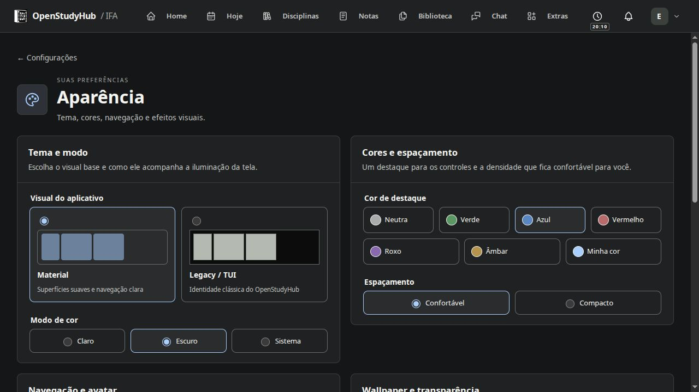
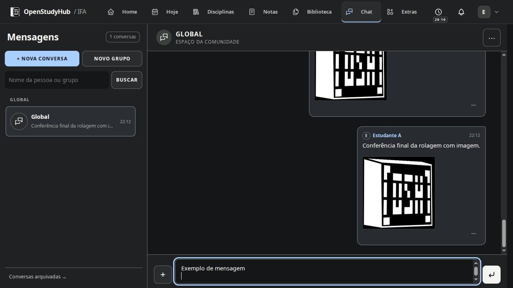

# Etapa 7 — entrega local

15/10/2026. Implementação autorizada, sem publicação nem acesso aos secrets do servidor. O código continua na V3 e os estilos Material/Legacy já aprovados são preservados.

## Configurações, por dentro e por fora

O portal tem oito cartões com ícone e resumo. Cada destino recebeu organização interna: Conta e perfil (foto, dados e acesso); Aparência (tema, cores, densidade, navegação, som e transparência); Home e atalhos (fundo, enquadramento, relógio, busca e editor dos atalhos); Notificações (preferências e dispositivo); Integrações (estado e ações); Acessibilidade e idioma; Ajuda; Sobre e Créditos. Campos relacionados ficam no mesmo cartão, com descrições curtas. Perfil tem salvamento explícito; preferências simples mostram estado do salvamento e erro com nova tentativa.

Links antigos continuam aceitos. Trocar a seção volta ao topo da área de conteúdo. Alterar idioma conserva o nome atual do perfil em vez de reenviar o nome antigo de outra aba. As etapas do Google não aparecem concluídas com a conta desconectada.

## Aparência e Chat

- Blur pessoal desligado por padrão, com três intensidades. Só aparece com wallpaper nas áreas compatíveis; sem imagem o fundo é sólido. Editores, jogos e Quadro Branco conservam a área de trabalho.
- Transições curtas na área do usuário, sem movimento contínuo; respeitam preferência do sistema e redução de movimento/transparência. Atualizações de chat não repetem a transição de página.
- Seta para a última mensagem ao sair do fim, mesmo sem mensagem nova. Histórico paginado pode voltar à janela recente. Rascunho e anexo são preservados.
- Botão Enviar com espaço próprio, alinhado ao campo e ícone vetorial; Enter envia, Shift+Enter quebra linha, sem interferir na seleção de menções nem na composição do teclado.

## Operação e dados

Backup criptografado com chave separada, bancos e arquivos locais geridos, inventário/checksums, rotina diária e retenção de cópias automáticas válidas. Arquivos apenas remotos são referências, não conteúdo copiado. A rotina começa desativada até configurar e guardar a chave. Exportação sanitizada ZIP antiga permanece distinta. Snapshots usam coordenação entre processos e janela de manutenção; compressão/criptografia/transporte não prolongam essa janela. Recuperação offline autentica o pacote e valida antes de substituir, preservando retorno dos bancos anteriores.

Admin recebe controles de backup, estado do trabalhador, configuração push/VAPID e diagnóstico privado. Saúde pública não expõe detalhes internos. Download de anexo usa stream e mantém autorização; multipart do chat tem limite contado. Cache de conexão canônica, cache curto/deduplicação de token e polling menor evitam trabalho repetido. Limites de eventos/conexões no realtime restringem abuso por socket/usuário.

## Conferência realizada

Testes técnicos dirigidos passaram para criptografia/chave inválida, backup/retenção/Drive simulado, limites de upload e acesso a anexos, autorização de download de backup, saúde pública, VAPID, reutilização de banco, cache de token, automação, limite realtime e preferências/idioma. Typecheck e builds de produção passaram; lint terminou sem erros, com dois avisos preexistentes de variáveis não usadas em project-deletion.test.ts. As entradas operacionais de realtime, backup e restore foram empacotadas em verificação dirigida.

Conferência visual limitada aos elementos alterados: portal e Aparência em tela ampla, grupos internos em janela intermediária, Notificações a 390×844 CSS sem transbordamento. Blur médio foi ligado, o salvamento confirmado e depois restaurado para desligado. No Chat, subir a conversa mostrou a seta sem mensagens novas; clicar voltou ao fim e preservou o rascunho, que foi apagado sem envio. O botão Enviar foi confirmado também pelo usuário; a medida em tela mostrou 8 px de separação, base alinhada ao campo e nenhum transbordamento. Shift+Enter inseriu uma quebra sem enviar. O retorno do grupo Home ao portal confirmou scrollTop 0. Backup/Diagnóstico do Admin foram conferidos visualmente: rotina/chave ainda não configuradas, ambos os bancos íntegros, aviso correto de realtime desligado e nenhuma largura excedente. A revisão visual ampla continua com o usuário.

Builds realizados com App/Admin/realtime desligados e memória limitada, uma tarefa pesada por vez. O build final completo levou cerca de 76 s e pico de 1,9 GiB. O [microbenchmark](evidence/stage7-runtime-benchmark.json) de 100 leituras em fixture caiu de 393,2 para 5,2 ms e RSS de 199,9 para 123,2 MiB (mediana de cinco processos); isso mede apenas esse helper, não a página inteira nem a RAM total.

## Limites e próxima etapa

- Drive/Classroom e push reais, imagem final, boot/rede tardia no gerenciador, falha de energia/processo e carga integrada ainda exigem o ensaio da etapa 8. Nenhum deles é declarado validado com base em mocks.
- ZIP grande de Projects ainda materializa buffers; a redução de cópias desta etapa cobre Chat/backup, não todo upload do aplicativo.
- Backup não baixa todos os arquivos externos. Google e inscrições push precisam ser reconectados após recuperação.
- Não foram habilitadas rotina de backup nem novas credenciais push na prévia.
- Prévia desligada ao concluir, conforme solicitado. Para revisar, ligar somente a instância necessária.

Guia: [Configurações](../../docs/configuracoes.md). Operação: [Backup e recuperação](../../docs/operations/manual-backup-restore.md).
