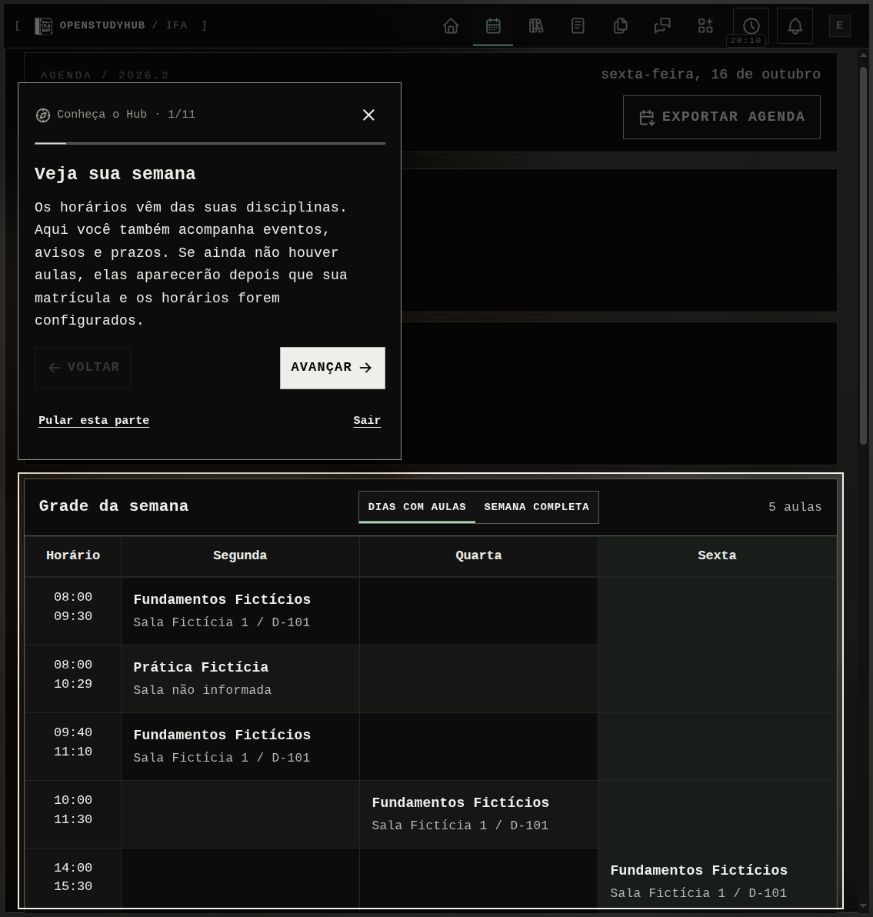
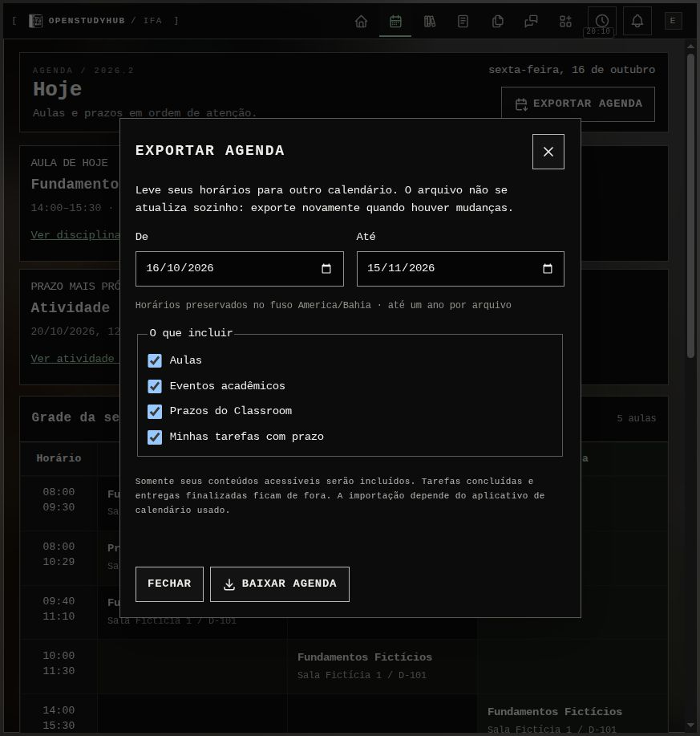
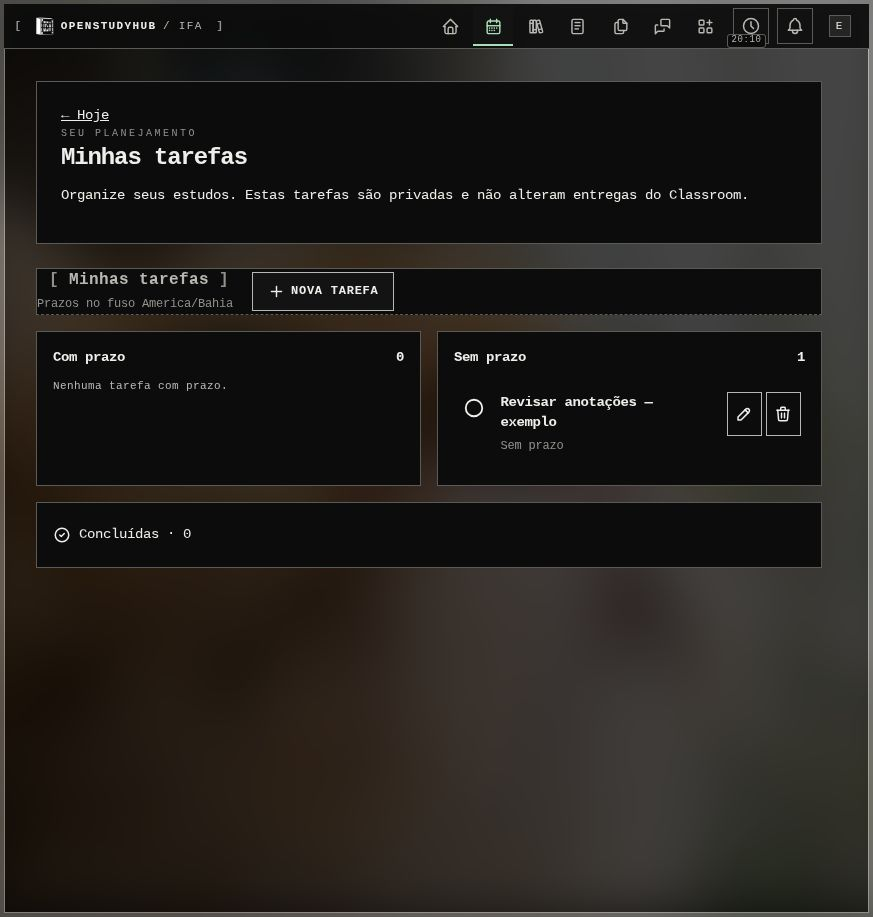

# Etapa 7 — complemento de agenda, tarefas e tour

16/10/2026. Escopo confirmado pelo mantenedor: **somente a etapa 7**. A rodada integrada da 8A será planejada em outra conversa; GitHub e implantação no servidor não foram iniciados.

## Entrega

- **Minhas tarefas:** resumo compacto em Hoje e gerenciamento em `/today/tasks`, sem nova entrada principal. Título, descrição, prazo e vínculo acadêmico opcional; concluir, reabrir, editar e excluir com confirmação. Lista privada por conta e independente do Classroom.
- **Exportar agenda:** seleção de período/conteúdos, arquivo .ics autenticado, classes expandidas pelo intervalo real, fuso explícito e identificadores estáveis. Sem assinatura pública ou sincronização de volta; somente dados acessíveis, sem tarefas/entregas concluídas.
- **Conheça o Hub:** tour sobre as páginas reais, com destaque, explicações práticas, progresso, voltar/avançar/pular/sair. Percursos completo e novidades, convite para contas novas e existentes, retomada/reinício pela Ajuda. Sem alterar preferências, enviar mensagens ou criar arquivos durante o percurso.
- **Admin:** controle do convite em Sistema → Recursos e modelos. Desligar o convite não remove o acesso pela Ajuda.

As ferramentas desativadas ficam fora do tour. A seleção de disciplinas valida matrícula atual e distingue IDs canônicos dos IDs da projeção. Tarefas/exportação ficam bloqueadas durante modo de prova; o tour não inicia nessa condição. Alterações concorrentes de progresso são detectadas por revisão.

## Dados e compatibilidade

Migração aditiva `0022_personal_planning_tour`: tarefas e progresso ligados ao usuário do App, índice por proprietário/prazo e registro da disponibilização desta edição. Incluída no journal e no helper de fixtures. Nenhuma substituição de perfis ou dados acadêmicos. O backup existente captura as tabelas junto do banco principal; **restauração integrada não ensaiada nesta rodada**.

Rotas novas: `/today/tasks` e download autenticado `/api/calendar/export`. Ações de tarefas e tour sempre resolvem a identidade da sessão no servidor. Passos do tour usam âncoras estáveis nas páginas, não texto traduzido ou classes específicas de tema. Nenhuma dependência nova.

## Verificação proporcional desta entrega

- Sete testes dirigidos aprovados: isolamento de tarefas, validação/posse, conclusão/reabertura, seleção de dados exportáveis, limites/datas/fuso, expansão de aulas, identificadores e escape/folding UTF-8 de iCalendar, progresso independente do perfil e conflito entre revisões. Alguns cenários compartilham o mesmo teste.
- Typecheck aprovado. Lint dirigido sem erros após corrigir a atualização de estado do destaque. Build de produção aprovado; uma segunda compilação foi necessária para corrigir duas incongruências encontradas na conferência visual.
- Na prévia, o convite apareceu para a conta fictícia existente. O percurso Novidades iniciou e gravou progresso; Sair guardou a posição. Uma tarefa **Revisar anotações — exemplo** foi criada na conta fictícia de conferência, sem prazo e sem disciplina.
- A janela de exportação abriu com seleção de período/conteúdo e retornou download com **19 compromissos** dos dados fictícios. Não foi importado em calendário externo nesta rodada.
- A conferência encontrou e corrigiu o fundo opaco herdado do tema nos diálogos do tour e o tamanho excessivo dos checkboxes da exportação. O balão passa a preferir espaço lateral quando disponível.

Nenhuma suíte completa, teste de carga, instalação limpa, atualização do servidor, OAuth/Drive real ou ensaio de recuperação foi feito nesta etapa. Esses percursos permanecem para a **8A, após combinar o roteiro com o usuário**.

A conferência final confirmou transparência do tour e balão lateral sem cobrir a grade na janela ampla. Retomada pela Ajuda observada na conta fictícia. A 390×844 pixels CSS, o balão e seus controles ficaram dentro da tela, sem transbordamento horizontal. A exportação corrigida apresentou checkboxes de aproximadamente 18 px e todos os controles dentro da janela. O novo controle do Admin foi conferido sem alterar sua configuração.

A compilação final terminou em cerca de 52 s, com pico de 1,9 GiB e 5,2 MiB de swap, com as prévias desligadas. As prévias voltaram a ser desligadas ao concluir. Antes da migração do banco **de QA**, foi guardada uma cópia consistente privada; nenhum banco do servidor foi acessado.

Guia de uso: [Agenda, tarefas e tour](../../docs/agenda-e-tour.md).
